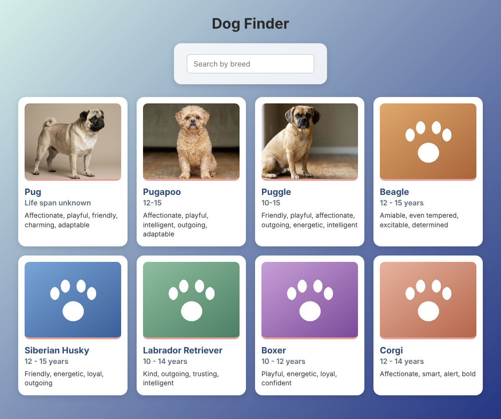

# 🐶 Dog Finder

## 👋 Welcome!

Build a small app that gets data from an API, using your own API key. This is a separate project from the Extensions Manager, so take it easy and have fun with it.

## 🎯 Requirements

You will build a React app that:

- Loads dog breeds from [The Dog API](https://thedogapi.com/) when the page opens
- Shows a card for the first eight breeds
- Keeps your API key out of GitHub
- Is deployed to a Netlify URL

**User stories:**

- As a user, when the page opens, I see a card for each of the first eight breeds
- As a user, each card shows the breed's image, name, life span and temperament
- As a user, I see "Life span unknown" or "Temperament unknown" if the API does not have them
- As a user, if a breed has no image, I see a placeholder image
- As a user, I see a loading message while the app waits for the dogs
- As a user, I see an error message if the dogs cannot load

Also:

- [ ] At least **three components**, using **props**
- [ ] Your code has comments
- [ ] Your API key is **not** in your GitHub repo
- [ ] You committed with meaningful messages and pushed to GitHub

**Bonus:** add a search box that shows only the breeds whose name matches what you type. If no breeds match, show a "No dogs found" message.

## 💎 What it should look like

Your design can be different. Make it your own.

## 🔗 Resources

- **The Dog API:** https://thedogapi.com/
- **Breeds endpoint:** `https://api.thedogapi.com/v1/breeds`
- **Placeholder image:** `https://placehold.co/300x200?text=No+Image`
- **Fetch API guide:** [MDN: Using Fetch](https://developer.mozilla.org/en-US/docs/Web/API/Fetch_API/Using_Fetch)
- **Vite environment variables:** [Env Variables and Modes](https://vite.dev/guide/env-and-mode)
- **Handy guides:** The teaching team at AnnieCannons has provided some [handy guides](https://docs.google.com/document/d/18jxCUA0bebCyYaIHy8aaKMgOQH4w5-b-iCGDWpV4K4M/edit?tab=t.0#heading=h.ykdbmvmlp0ag) to help you use GitHub and other coding tools

## 🚀 Roadmap

### ⚙️ Fork and clone

1. Fork this repo. Use this [fork and clone guide](https://docs.google.com/document/d/18jxCUA0bebCyYaIHy8aaKMgOQH4w5-b-iCGDWpV4K4M/edit?tab=t.55gk3qetux2a#heading=h.wbbot8ebr58a).
2. Clone **your fork** into your `dev` folder.
3. Open the `dog-finder` folder in VS Code, then run `npm install` and `npm run dev`.

### ⚙️ Get your API key

1. Sign up at https://thedogapi.com/ and click **Get your API key**.
2. The API wants your key in a header called `x-api-key` on every request.

### ⚙️ Keep your key out of GitHub

1. In the root of your project, create a file named `.env` with one line: `VITE_DOG_API_KEY=your_key_here`
2. Open `.gitignore` and add a line that says `.env`. Do this **before** you commit.
3. Run `git status`. Your `.env` file should **not** be in the list.
4. In your code, read the key with `import.meta.env.VITE_DOG_API_KEY`.
5. Restart `npm run dev` after you create or change `.env`.

If you ever push your key by accident, get a new key on the Dog API site.

### ⚙️ Pseudo-code

Fill out `pseudo-code.txt` before you write code.

### ⚙️ Build, commit, push and deploy

Work on one feature at a time. Commit every time something works, with a message that says what you did. Push to GitHub.

Before you deploy to Netlify, add your key there too: **Site configuration, then Environment variables**. Use the same name, `VITE_DOG_API_KEY`. Then deploy again.
